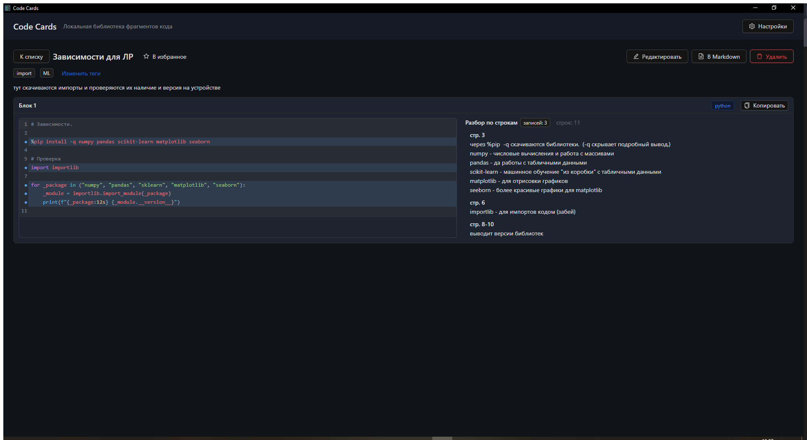
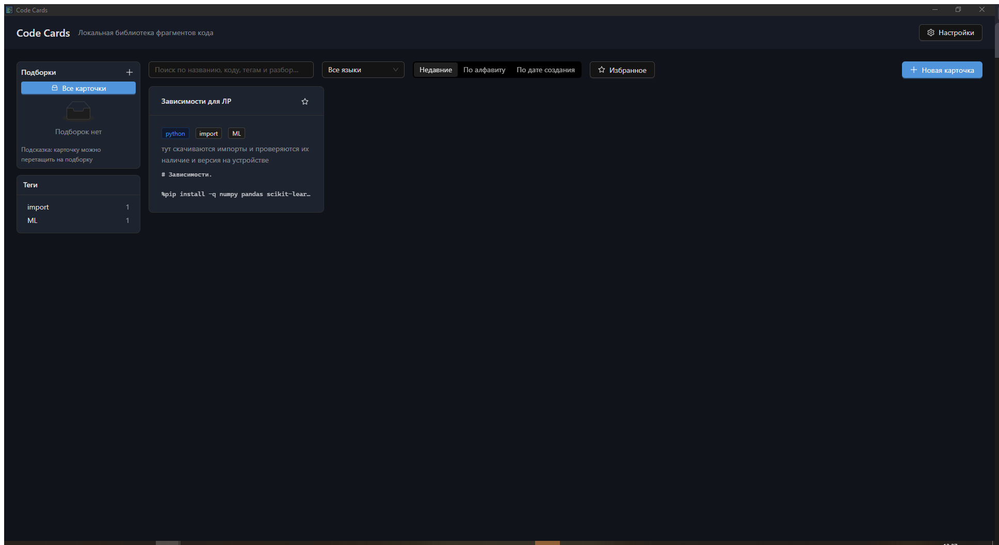
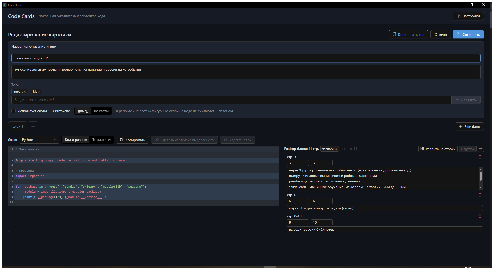

<div align="center">

# 📇 Code Cards

**Локальная библиотека фрагментов кода с разбором по строкам**

Карточка - это не просто сохранённый текст. Это код, к которому привязаны пояснения
к конкретным строкам, теги, подборки и, при желании, параметры-слоты.

Ни одного сетевого запроса. Всё лежит в файле рядом с приложением.


</div>

---

## Зачем это

Обычные заметки со сниппетами отвечают на вопрос «что этот код делает».
Через полгода нужен другой ответ: **по каким строкам это видно**. Поэтому здесь
разбор привязан к диапазонам строк и переживает правку кода.

Три принципа, из которых выросло всё остальное:

| Принцип | Что это значит на практике |
| --- | --- |
| ⚡ **Быстрое сохранение** | Вставил код - сохранил. Разбор и теги добавите позже, без потери данных |
| 🔍 **Повторное понимание** | Открыли карточку - видно, что делает код и какими строками это подтверждается |
| 🔒 **Полная автономность** | Нет ни одного сетевого запроса. База лежит в `data/app.db` рядом с программой |

### Идея из Factorio

Главная особенность - **карточка как чертёж**. Как в Factorio чертёж не просто
картинка завода, а параметризованная схема, которую ставят в проект много раз с
разными значениями, здесь карточка умеет быть шаблоном со слотами `{{имя}}`:

```python
@lru_cache(maxsize={{размер}})
def {{имя_функции}}(x):
    return {{что_вернуть}}
```

Подставляете значения - получаете готовый код и копируете одной кнопкой.
А если у вас уже есть готовый код, кнопка **«Сделать чертёж из выделенного»**
превратит выделенный фрагмент в слот, сохранив его как значение по умолчанию.

---

## Возможности

<table>
<tr><td width="50%" valign="top">

### 📝 Карточки и разбор
- Несколько блоков кода в одной карточке, у каждого свой язык и свой разбор
- Разбор - свободный текст на диапазон строк `от`-`до`
- Двусторонняя подсветка: клик по строке кода подсвечивает пояснение и наоборот
- Кнопка «Разбить на строки»: пустые заготовки под все непустые строки
- Избранное, сортировки (недавние, по алфавиту, по дате создания)

### 🧠 Умный перенос разбора
- Правите код - разбор едет за строками по смыслу, через алгоритм патчей
- Перед сохранением показывается сводка: **сдвинуто / изменено / потеряно**
- Изменённые пояснения помечаются жёлтым бейджем «устарело», но **не удаляются**
- Переставленные блоки кода тоже отслеживаются

</td><td width="50%" valign="top">

### 🔎 Поиск
- По названию, описанию, тегам, коду и текстам разбора
- Точный, без исправления опечаток
- Работает даже по пунктуации: `arr[0]`, `===`, `->`
- Живой, с подсветкой совпадений в результатах
- Фильтры: теги (И), язык, подборка, избранное

### 🗂 Теги и подборки
- Теги свободные, с автодополнением и счётчиками карточек
- `JS` и `js` - один тег, без дублей
- Подборки - вложенное дерево с ручным порядком карточек
- Одна карточка может лежать в нескольких подборках

</td></tr>
<tr><td valign="top">

### 💾 Данные
- Резервная копия базы при запуске, если прошли сутки (10 последних)
- Копия делается через `VACUUM INTO`, а не копированием файла: иначе в режиме WAL получается неполная база
- Экспорт и импорт всего архива в читаемый JSON
- Экспорт карточки в Markdown: код плюс разбор таблицей

</td><td valign="top">

### ⌨️ Работа с клавиатуры
| Сочетание | Действие |
| --- | --- |
| `Ctrl+N` | Новая карточка |
| `Ctrl+F` | Фокус в поиск |
| `Ctrl+S` | Сохранить карточку |
| `Esc` | Закрыть редактор без сохранения |
| `Ctrl+Shift+C` | Копировать код открытой карточки |

Тёмная тема по умолчанию, светлая - в настройках.

</td></tr>
</table>

---

## Скриншоты

<div align="center">

**Просмотр карточки.** Слева код с маркерами разобранных строк, справа разбор по
строкам. Клик по строке подсвечивает пояснение и наоборот.



**Список и панели.** Подборки и теги со счётчиками слева, живой поиск,
фильтр по языку, сортировки и избранное сверху.



**Редактор.** Название, описание, теги, галочка слотов, блок кода и редактор
разбора рядом с ним.



</div>

---

## Установка

Готовый установщик лежит в разделе **Releases**: `Code Cards_0.1.0_x64-setup.exe`.
Ставится без прав администратора, в профиль пользователя.

Требования: Windows 10/11. WebView2 в системе уже есть.

---

## Сборка из исходников

### Что нужно

- **Rust** stable с тулчейном `x86_64-pc-windows-msvc` (проверено на 1.99.1)
- **Node.js** 20+ и npm 10+
- **Visual Studio** с ворклоад «Разработка классических приложений на C++»
  (компилятор MSVC и Windows SDK)

### Команды

```bat
npm install
scripts\build.bat
```

Установщик появится в `src-tauri\target\release\bundle\nsis\`.

Для разработки:

```bat
scripts\dev.bat        :: окно приложения с горячей перезагрузкой фронтенда
npm run dev            :: только фронтенд на порту 1420
```

### Проверки

```bat
npm run build                                        :: типы и сборка фронтенда
cd src-tauri && ..\scripts\cargo.bat test            :: 55 тестов Rust
cd src-tauri && ..\scripts\cargo.bat build --release :: релизная сборка
```

---

## Архитектура

```
┌─────────────────────────────────────────────┐
│  React 18 + Ant Design 5 + CodeMirror 6     │
│  знает только про invoke(), никакого SQL    │
└──────────────────┬──────────────────────────┘
                   │  команды Tauri (serde, camelCase)
┌──────────────────▼──────────────────────────┐
│  Rust: бизнес-логика                        │
│  ├── перенос разбора (crate similar)        │
│  ├── сборка поисковой строки                 │
│  ├── разбор и подстановка слотов             │
│  └── бэкапы, экспорт, импорт                 │
└──────────────────┬──────────────────────────┘
                   │  rusqlite (bundled SQLite 3.54)
┌──────────────────▼──────────────────────────┐
│  SQLite + FTS5                              │
│  data/app.db, data/backups/                 │
└─────────────────────────────────────────────┘
```

**Почему SQL живёт в Rust, а не во фронтенде.** Логика переноса разбора и
сборка поисковой строки - это вычисления над данными, а не запросы. Через
`tauri-plugin-sql` они оказались бы в React и перестали бы тестироваться.
Теперь вся эта логика покрыта тестами и меняется независимо от интерфейса.

### Структура

```
code-cards/
├─ scripts/                 bat-обёртки запуска и сборки
├─ src/                     React
│  ├─ api/tauri.ts          единственное место связи с Rust, типы DTO
│  ├─ components/           экраны и виджеты
│  ├─ hooks/                TanStack Query хуки
│  └─ theme/                тёмная и светлая темы
└─ src-tauri/               Rust
   └─ src/
      ├─ lib.rs             регистрация команд, состояние приложения
      ├─ db/                открытие базы, WAL, миграции, FTS
      ├─ commands/          карточки, разбор, теги, поиск, подборки, бэкапы
      ├─ line_diff.rs       перенос разбора при правке кода
      └─ slots.rs           разбор {{...}} и подстановка
```

---

## Как устроены две самые важные части

### Перенос разбора при правке кода

Требование из спецификации звучит жёстко: **молча терять пояснения запрещено**.
Поэтому перенос устроен консервативно.

1. Старый и новый код сравниваются построчно алгоритмом патчей (`similar`).
2. Строится отображение «старая строка → новая строка».
3. Второй проход ищет строки, которые на самом деле **переехали**: дифф часто
   изображает перестановку как удаление плюс вставку, и без этого прохода
   перенесённый блок считался бы потерянным.
4. Диапазон переносится: обе границы нашлись - без пометки; часть потерялась -
   усекается и помечается `устарело`; всё потерялось - запись **остаётся**,
   прижимается к ближайшей строке и помечается.
5. Перед записью в базу возвращается сводка, и сохранение происходит только
   после подтверждения.

### Поиск по коду и пунктуации

FTS5 не индексирует пунктуацию, поэтому запрос разбирается на две части:

| Часть запроса | Куда идёт | Пример |
| --- | --- | --- |
| Слова (буквы, цифры, `_`) | FTS5, префиксный `MATCH` | `lru_cache` → `"lru_cache"*` |
| Символьные куски | `LIKE` по коду | `arr[0]` → слова `arr`, `0` и кусок `[]` |

Результаты объединяются по `id` карточки без дублей. Именно поэтому запрос
`arr[0]` находит карточку с такой строкой, а просто `[` - тоже.

---

## Технические решения

| Слой | Выбор | Почему так |
| --- | --- | --- |
| Оболочка | Tauri 2 | Настоящее окно, установщик 2.6 МБ, системный WebView2 |
| Ядро | Rust + `rusqlite` (`bundled`) | SQLite внутри бинарника, FTS5 доступен из коробки, логика тестируема |
| База | SQLite + FTS5 | Один файл, полнотекстовый поиск без внешних сервисов |
| Патчи строк | crate `similar` | Проверенный алгоритм диффа, не надо писать свой |
| Фронтенд | React 18 + TypeScript | Строгие типы DTO повторяют структуры serde |
| UI | Ant Design 5 | Готовые компоненты и тёмная тема |
| Данные | TanStack Query | Кэш и инвалидация без ручного состояния |
| Редактор | CodeMirror 6 | Подсветка нужных языков, расширяемые декорации строк |

---

## Проверка

Проверено на реальных данных, не только юнит-тестами.

| Что | Результат |
| --- | --- |
| Тесты Rust | **55 пройдено**, 0 провалов, 0 предупреждений |
| Сборка фронтенда | `tsc -b` без ошибок, `vite build` проходит |
| Установщик NSIS | собран, 2.62 МБ |
| Сквозной сценарий на файле базы | все пункты пройдены |

Сквозной сценарий проверяет на настоящем файле базы: создание карточки с кодом и
разбором, поиск по названию, тегу, коду, тексту разбора и по `arr[0]`, удаление
строки кода и появление сводки `сдвинуто=1, потеряно=1` без записи в базу,
сохранение после подтверждения с уцелевшим разбором, теги со счётчиками,
вложенные подборки, подстановку слота, отключение слотов в режиме «не слоты»,
экспорт и импорт JSON без потерь.

Покрыты тестами и конкретные ошибки, найденные при ручной эксплуатации:

- карточка не открывалась в редакторе (запрос выполнялся только для просмотра);
- сохранение падало с `database disk image is malformed` при добавлении тега
  (строка индекса снималась после изменения данных, а не до);
- ошибки показывались как `undefined` (Rust отдаёт строку, а не `Error`).

---

## Особенности окружения Windows

Приложение обычное, но сборка на конкретной машине потребовала решений.
Они уже в коде, здесь - чтобы не наступить снова.

<details>
<summary><b>Visual Studio в нестандартном каталоге, <code>vswhere.exe</code> нет</b></summary>

`find-msvc-tools` не находит компилятор. Все скрипты в `scripts/` сначала
вызывают `vcvars64.bat`, потом cargo. Обходите cargo только через
`scripts\cargo.bat`.
</details>

<details>
<summary><b>Полный debuginfo ломает сборку SQLite (<code>D8050</code>)</b></summary>

`cc-rs` собирает `sqlite3.c` с флагом `-Z7`, и MSVC 14.51 падает. В
`src-tauri/Cargo.toml` для профиля `dev` стоит `debug = 0`. Параметр
`debug = "line-tables-only"` не помогает: для C-файлов он всё равно даёт `-Z7`.
</details>

<details>
<summary><b>esbuild не может писать в системный TEMP</b></summary>

Сборка фронтенда идёт через `scripts/frontend.mjs`: скрипт переносит
`TMP`/`TEMP` внутрь проекта. Прямой `npx vite build` на такой машине упадёт.
</details>

<details>
<summary><b>Кириллица в <code>.bat</code> ломает cmd</b></summary>

Строки выполняются как команды, `PATH` теряет компилятор, коды возврата врут.
Все bat-файлы написаны латиницей с CRLF. Русские комментарии - в `.rs`, `.toml`,
`.ts`, `.mjs`.
</details>

<details>
<summary><b>Вторая копия приложения не запускается</b></summary>

Два процесса не делят один каталог WebView2: `WindowsError(0x800700AA)`,
«Требуемый ресурс занят». Это ограничение движка. Для второй копии нужен
отдельный каталог WebView2.
</details>

---

## Спецификация

Полное описание функциональности, модель данных, контракт команд и порядок
этапов - в [ПЛАН-РАЗРАБОТКИ.md](ПЛАН-РАЗРАБОТКИ.md). Этот документ писался до
реализации и служил ей опорой.

---

## Лицензия

MIT. См. [LICENSE](LICENSE).

<div align="center">

Сделано как база знаний для учёбы: код разбирается по строкам, чтобы
через полгода понять его за минуту.

</div>
